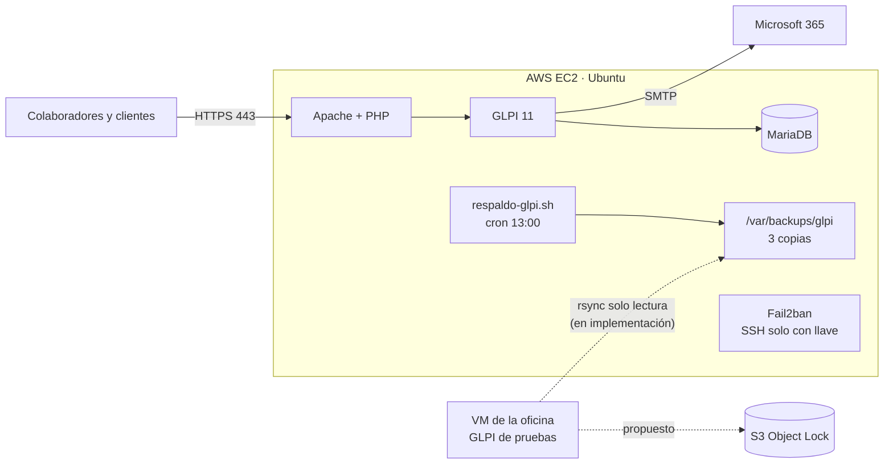

# Mesa de ayuda con GLPI en AWS

Implementación de una mesa de ayuda (service desk) para el área de Soporte y Mantención de una empresa de integración tecnológica, sobre **GLPI 11** en un servidor **Ubuntu en AWS EC2**: desde una máquina virtual de pruebas hasta producción con dominio propio, HTTPS, endurecimiento del servidor y respaldo diario.

El reto no fue instalar GLPI, sino **adaptarlo a los procesos de la empresa** para que clientes y colaboradores vieran "Soporte Técnico" y no un software genérico, y que cada adaptación sobreviviera a las actualizaciones.

> Proyecto realizado durante mi práctica profesional (septiembre a noviembre de 2026). Hice el diseño, la configuración, la documentación y la administración del servidor por SSH. La cuenta de AWS (consola, red, IP elástica) y el DNS los administraba el jefe del área.
> Los nombres, dominios, direcciones y colores de este repositorio son de ejemplo.

---

## Qué resuelve

| Antes | Después |
| --- | --- |
| Pedidos a Soporte por correo, WhatsApp y teléfono, sin registro | Todo pedido entra como ticket, con número, responsable y estado |
| Sin plazos claros | Primera respuesta definida según el protocolo interno: 2 horas hábiles, con prioridades P1 a P4 |
| Sin trazabilidad entre clientes y trabajos internos | Dos series de casos propias (**AT** para clientes, **IN** para internos) y vínculo con el código de venta de la empresa |
| Sistema genérico en inglés técnico | Marca blanca: colores, logo, vocabulario y correos de la empresa, en español |

## Stack

`GLPI 11` · `Ubuntu Server LTS` · `Apache 2` · `PHP 8.5` · `MariaDB` · `AWS EC2` · `Let's Encrypt / certbot` · `Fail2ban` · `Microsoft 365 (SMTP)` · `Bash` · `cron` · `rsync` · `VirtualBox`

## Arquitectura



Detalle en [docs/arquitectura.md](docs/arquitectura.md).

## Qué hice

**Adaptación de GLPI al negocio**
- Modelo de **entidades y perfiles**: una entidad por cliente, una interna y cuatro perfiles (Super-Admin, Admin/técnico, Interno y Cliente), con portal simplificado para quienes solo piden.
- **Formulario interno** que reemplazó los correos a Soporte: seis tipos de trabajo, cada uno con sus preguntas, su categoría y su destino.
- **Numeración propia AT/IN** con una tabla de contadores y un disparador en MariaDB, sin plugins → [glpi/sql/codigo-caso.sql](glpi/sql/codigo-caso.sql).
- **Notificaciones** propias (nuevo, asignado, resuelto) con plantillas HTML de la empresa; aviso final al resolver, no al cerrar.
- **Flujo de atención** alineado al protocolo interno: prioridades P1 a P4, primera respuesta en 2 horas hábiles, cierre por inactividad y derivación a otras áreas.

**Marca blanca**
- CSS de la entidad raíz: colores, logo en base64 y "Tickets" en vez de "Casos" → [glpi/css/personalizacion-marca.css](glpi/css/personalizacion-marca.css).
- Ícono y título de la pestaña desde Apache, sin tocar archivos de GLPI → [server/apache/personalizacion-marca.conf](server/apache/personalizacion-marca.conf).
- Traducción propia en `files/_locales` para quitar textos de fábrica de los correos → [glpi/locales/README.md](glpi/locales/README.md).

**Servidor y operación**
- Migración de la VM de pruebas a **AWS EC2**, instalación desde cero.
- Dominio con **HTTPS** (Let's Encrypt, renovación automática probada) y redirección http → https → [server/apache/glpi.conf](server/apache/glpi.conf).
- **Endurecimiento:** SSH solo con llave, Fail2ban, `cookie_secure`, cuentas de fábrica desactivadas, instalador retirado → [docs/seguridad.md](docs/seguridad.md).
- **Respaldo diario** con verificación de integridad y retención → [server/backup/respaldo-glpi.sh](server/backup/respaldo-glpi.sh) · [docs/respaldo.md](docs/respaldo.md).
- **Runbook de recuperación ante desastre** → [docs/recuperacion.md](docs/recuperacion.md).

**Documentación y capacitación**
- Manuales por perfil (colaborador, técnico, administrador), guía de instalación, bitácora diaria y un plan de formación para el equipo.

## Decisiones clave

Cada decisión, con las alternativas evaluadas y el porqué, está en [docs/decisiones/](docs/decisiones/):

| # | Decisión |
| --- | --- |
| [001](docs/decisiones/001-respaldo-pull.md) | Respaldo *pull*: la máquina de respaldo va a buscar la copia; el servidor no la envía |
| [002](docs/decisiones/002-numeracion-con-disparador.md) | Numeración AT/IN con un disparador en la base de datos, no con un plugin |
| [003](docs/decisiones/003-idioma-y-traduccion-propia.md) | Español (México) y traducción propia en `files/_locales`, sin editar archivos `.po` |
| [004](docs/decisiones/004-permisos-no-css.md) | Ocultar menús quitando permisos, nunca con CSS |
| [005](docs/decisiones/005-personalizacion-fuera-de-glpi.md) | Toda personalización fuera del código de GLPI, para sobrevivir a las actualizaciones |
| [006](docs/decisiones/006-aviso-al-resolver.md) | El aviso final se envía al resolver, no al cerrar |
| [007](docs/decisiones/007-ssh-llave-y-fail2ban.md) | SSH solo con llave + Fail2ban, sin restringir por IP |
| [008](docs/decisiones/008-vm-de-pruebas.md) | Todo cambio se prueba primero en una VM |

## Estructura

```
├── docs/
│   ├── arquitectura.md          # componentes, capas de configuración, flujo de un ticket
│   ├── decisiones/              # ADR: qué se decidió y por qué
│   ├── personalizacion.md       # cómo se adaptó GLPI al negocio
│   ├── seguridad.md             # checklist de endurecimiento
│   ├── respaldo.md              # estrategia de respaldo
│   ├── recuperacion.md          # runbook ante pérdida del servidor
│   └── lecciones-aprendidas.md  # problemas reales y cómo se resolvieron
├── glpi/
│   ├── css/                     # marca blanca
│   ├── locales/                 # traducción propia
│   └── sql/                     # numeración AT/IN
└── server/
    ├── apache/                  # sitio, redirección HTTPS, pestaña
    ├── backup/                  # script de respaldo diario
    ├── fail2ban/                # jail.local
    └── php/                     # cookie_secure
```

## Estado

| Componente | Estado |
| --- | --- |
| GLPI en producción con HTTPS y marca blanca | En uso |
| Numeración AT/IN | En uso |
| Endurecimiento del servidor | Aplicado |
| Respaldo diario en el servidor | Script probado; copia externa por *pull* en implementación |
| Copia inmutable en S3 (Object Lock) | Propuesto |

## Lo que aprendí

Los problemas que más enseñaron están en [docs/lecciones-aprendidas.md](docs/lecciones-aprendidas.md). Los tres que más me marcaron:

- **Lo que vive en el servidor no viaja con la base de datos.** El ícono de la pestaña se perdió en la migración porque estaba en Apache. Desde entonces, cada ajuste queda documentado según la capa donde vive.
- **Un mensaje de éxito no es una prueba.** Certbot dijo que todo estaba bien y la redirección a HTTPS no funcionaba. Comprobar con `curl -I` antes de dar algo por hecho.
- **Aislar variables antes de culpar a algo.** El correo fallaba desde AWS y funcionaba desde la VM con la misma cuenta: el problema era desde dónde salía la conexión, no GLPI.

---

**Daniel Gutiérrez** · Analista Programador · Santiago, Chile
