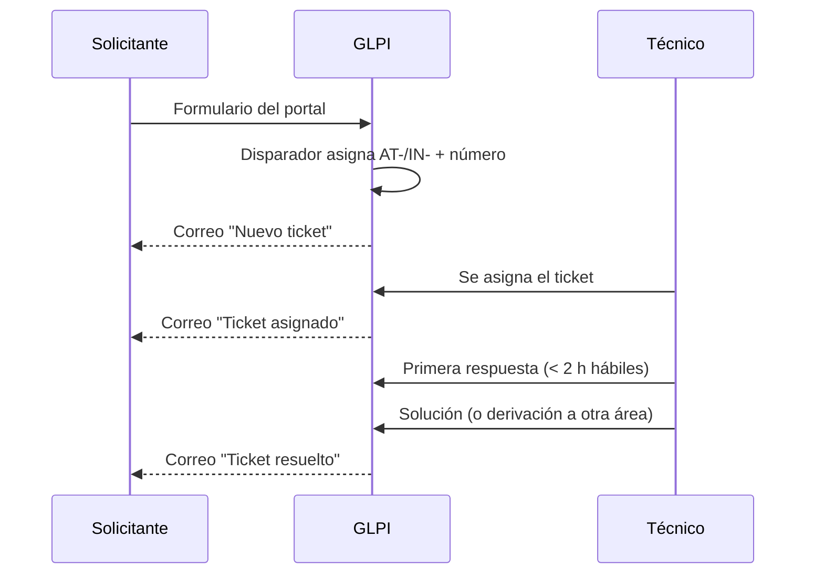

# Arquitectura

## Componentes

| Componente | Qué es | Detalle |
| --- | --- | --- |
| Producción | Instancia **AWS EC2** con Ubuntu Server LTS | IP elástica (fija), dominio propio con HTTPS |
| Servidor web | Apache 2 + PHP 8.5 (módulo de Apache) | Sitio 80 (redirige) y sitio 443 (lo crea certbot) |
| Aplicación | GLPI 11 | `DocumentRoot` en `/var/www/glpi/public` |
| Base de datos | MariaDB | Base `glpi` (~58 MB al momento de la implementación) |
| Correo saliente | Microsoft 365 por SMTP | Notificaciones de ticket nuevo, asignado y resuelto |
| Ambiente de pruebas | VM con Ubuntu Server en VirtualBox, en un notebook de la oficina | Copia de GLPI para probar cambios; también es la máquina que va a buscar el respaldo |

## Las tres capas donde vive la configuración

La decisión más útil del proyecto fue documentar **en qué capa vive cada ajuste**, porque eso determina qué se recupera solo al restaurar un respaldo y qué hay que rehacer a mano.

| Capa | Qué guarda | ¿Viaja con un respaldo de la base? |
| --- | --- | --- |
| Base de datos | Todo lo configurado en pantalla: cuentas, perfiles, formularios, plantillas, CSS de la entidad, tableros y la numeración AT/IN (tabla + disparador) | Sí |
| `files/` y `config/` | Adjuntos, traducción propia (`files/_locales`) y la llave interna con que GLPI protege las contraseñas que guarda | Sí (el respaldo diario las incluye) |
| Archivos del servidor | Sitios de Apache, certificado HTTPS, `php.ini`, Fail2ban, ícono de la pestaña, script de respaldo | **No**: se rehacen a mano |

Archivos del servidor que hay que rehacer en una reinstalación:

| Archivo | Para qué |
| --- | --- |
| `/etc/apache2/sites-available/glpi.conf` | Sitio 80, nombres y redirección a https |
| `/etc/apache2/sites-available/glpi-le-ssl.conf` | Sitio 443 (lo genera certbot) |
| `/etc/apache2/conf-available/personalizacion-marca.conf` | Ícono y título de la pestaña |
| `/var/www/marca-assets/favicon.png` | Ícono de la empresa |
| `/etc/php/8.5/apache2/php.ini` | `session.cookie_secure = On` |
| `/etc/fail2ban/jail.local` | Ajustes de Fail2ban |
| `/usr/local/sbin/respaldo-glpi.sh` + cron | Respaldo diario |

## Modelo de acceso

```
Empresa (raíz)           ← Super-Admin y técnicos (autorización recursiva)
├── Interno              ← colaboradores de las áreas: formulario interno → tickets IN
├── Cliente A            ← contactos del cliente: formularios de clientes → tickets AT
└── Cliente B ...
```

| Perfil | Quién | Interfaz |
| --- | --- | --- |
| Super-Admin | Administradores del sistema | Estándar; configura todo |
| Admin | Técnicos de Soporte y Mantención | Estándar; atiende tickets de todas las entidades, sin inventario |
| Interno | Personal de las áreas | Portal simplificado |
| Cliente | Contactos de cada cliente | Portal simplificado |

Cada cuenta tiene **una sola autorización** (perfil + entidad + recursivo). Los perfiles se crean clonando uno existente, nunca desde cero.

## Flujo de un ticket



## Red y acceso al servidor

- Puertos abiertos: **80** (redirección y renovación del certificado), **443** (sitio) y **22** (SSH).
- SSH solo con llave; Fail2ban bloquea las IP que fallan repetidamente.
- El puerto 80 no se puede cerrar: certbot lo usa para renovar el certificado.
